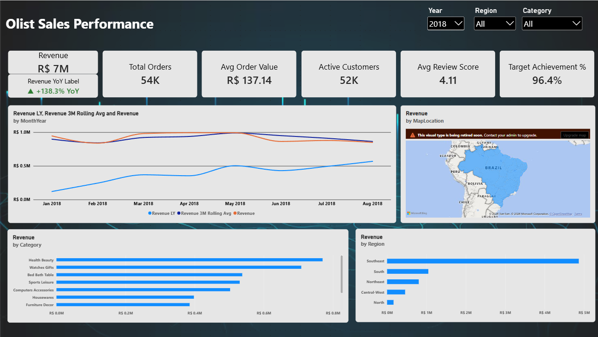
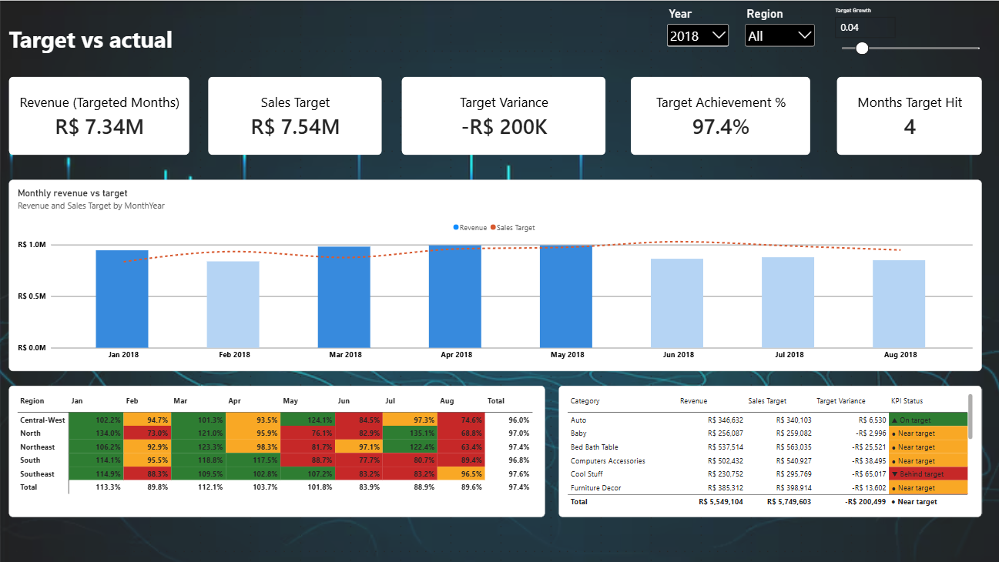
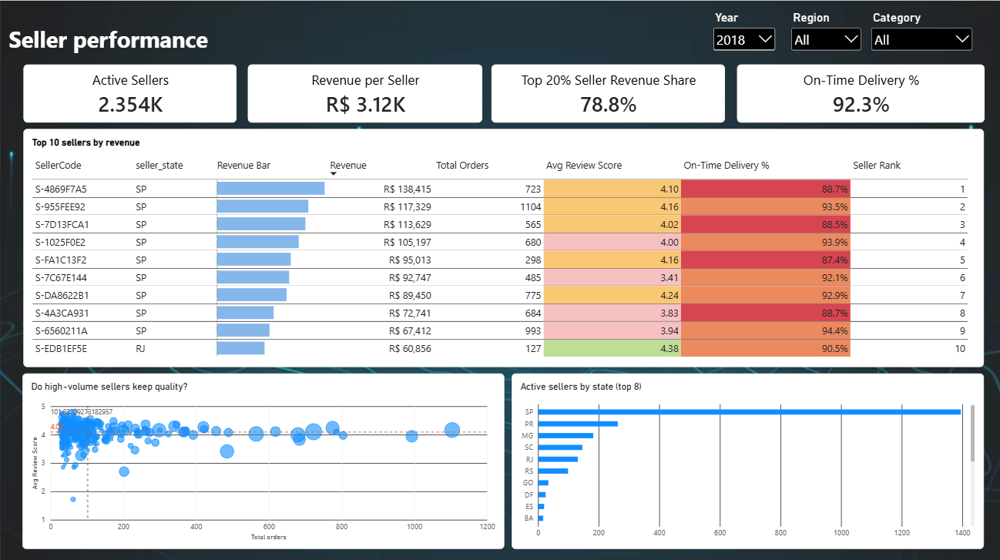
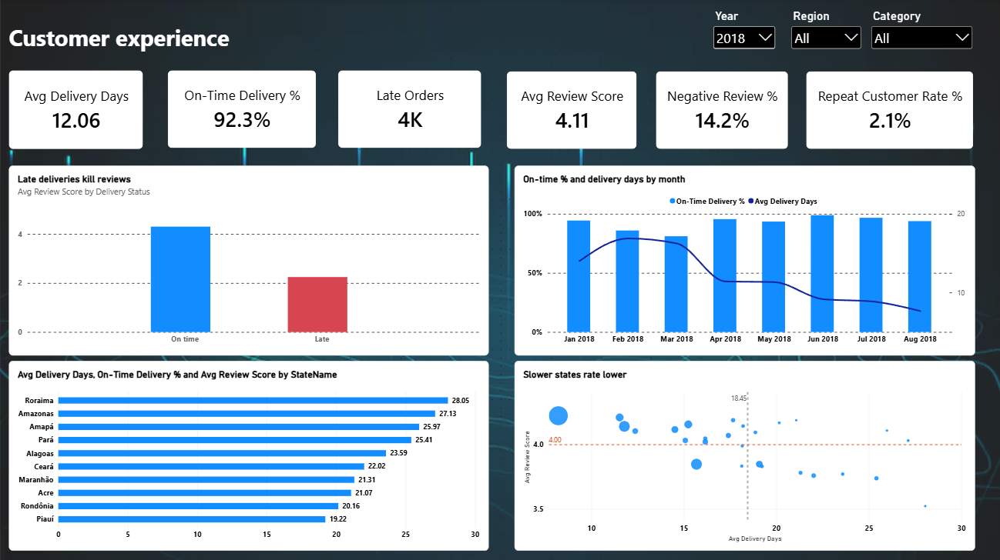
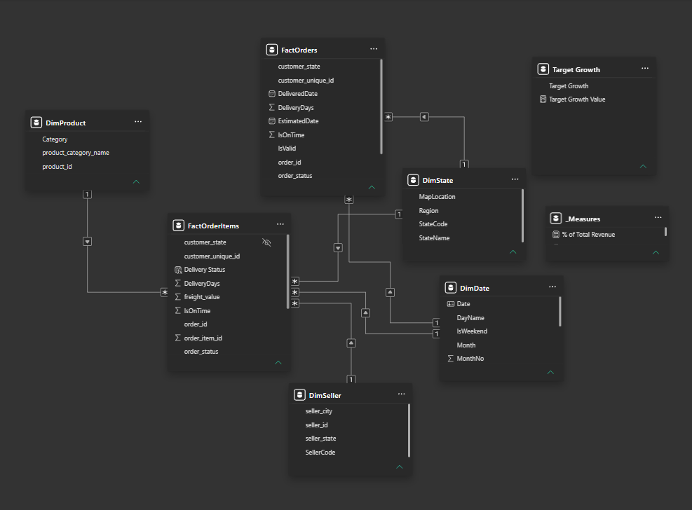

# 📊 Sales Performance Dashboard — Power BI

An interactive 4-page Power BI dashboard analysing **~98,000 real e-commerce orders** from **Olist**, Brazil's largest department-store marketplace (Jan 2017 – Aug 2018). It tracks revenue KPIs, target achievement, seller performance and customer experience.



## 🎯 Business Questions
1. How fast is the business growing, and is it hitting its monthly targets?
2. Which regions, states and product categories drive revenue?
3. Who are the top sellers, and do they keep service quality high?
4. How does delivery performance affect customer satisfaction?

## 💡 Key Insights (2018, Jan–Aug)

**1. Growth is strong year-on-year but stalled in mid-2018.**
Revenue grew **+138%** versus Jan–Aug 2017, but monthly revenue plateaued at around R$0.85–0.99M. Only **4 of 8 months** hit target (96.4% overall achievement), and **all five regions missed target in June**. This points to a company-wide slowdown, not a regional problem.
→ *Recommendation:* investigate demand drivers for H2. The run-rate target method should also account for seasonality: November 2017's Black Friday spike (R$1.0M) inflated the targets for the following months.

**2. Late deliveries are the biggest driver of bad reviews.**
On-time orders average **4.30★**, but late orders average just **2.24★**. Most late orders end in a 1–2★ review, compared with roughly 1 in 10 on-time orders.
→ *Recommendation:* treat on-time delivery as a core KPI. It moves customer satisfaction more than anything else in the data.

**3. Delivery speed depends heavily on geography.**
São Paulo customers receive orders in **8.2 days** on average. In the North and Northeast it takes **20–28 days** (Roraima 28, Amazonas 27, Pará 25), and those states also give lower reviews.
→ *Recommendation:* prioritise regional fulfilment or carrier partnerships in the North and Northeast before pushing more marketing spend there.

**4. Revenue depends on a small group of sellers, and they deliver late more often.**
The **top 20% of sellers generate 78.8%** of revenue. Yet none of the top 10 sellers reaches 95% on-time delivery, and 4 of them are below 90%.
→ *Recommendation:* introduce delivery SLAs and monitoring for top-tier sellers. Their failures affect the most customers.

**5. Almost every customer buys only once.**
The repeat-customer rate is just **2.1%** in 2018. Growth is coming almost entirely from new customers.
→ *Recommendation:* retention programmes (post-delivery follow-up, vouchers for a second purchase) are an untapped lever, especially after fixing delivery issues that hurt first impressions.

**6. Category performance is mixed.**
Health & Beauty (109%) and Housewares (114%) beat their targets, while Toys (66%) and Cool Stuff (77%) fell furthest behind.

## 📑 Report Pages
| Executive Overview | Target vs Actual |
|---|---|
|  |  |
| **Seller Performance** | **Customer Experience** |
|  |  |

- **Executive Overview**: headline KPIs with YoY, revenue trend vs last year, revenue by state, region and category.
- **Target vs Actual**: monthly revenue vs target, with an adjustable *Target Growth* slider. Region × month achievement matrix with red/amber/green status, and categories furthest behind target.
- **Seller Performance**: top-10 leaderboard with service-quality flags, volume-vs-quality scatter, seller concentration.
- **Customer Experience**: review score by delivery status, monthly on-time trend, slowest states, delivery-vs-review by state.

## 🛠️ Skills Demonstrated
| Area | What I did |
|---|---|
| **Power Query (M)** | Cleaned 7 raw tables: translated categories, handled missing values and duplicate reviews, de-duplicated customers, set a date window, used staging queries and a folder parameter |
| **Data Modelling** | Star schema with 2 fact tables at different grains (order and order item) sharing 5 dimensions; avoided ambiguous relationship paths |
| **DAX** | 50+ measures: core KPIs, time intelligence (YoY, YTD, MoM, rolling average), run-rate targets driven by a what-if parameter, RANKX, Pareto analysis, order-level averages, conditional-format colour measures, dynamic labels |
| **KPI Design** | Revenue, AOV, Target Achievement %, On-Time Delivery %, Avg Review Score, Negative Review %, Repeat Customer Rate, with red/amber/green status |
| **Visualisation** | 4 report pages, combo charts, matrix heatmap, scatter quadrants with average lines, data bars, synced slicers |

## 📐 Data Model


| Table | Rows | Grain |
|---|---|---|
| FactOrderItems | 111,752 | One row per item in a valid order |
| FactOrders | 99,092 | One row per order (all statuses) |
| DimProduct | 32,951 | Product → category |
| DimSeller | 3,095 | Seller, city, state |
| DimState | 27 | Brazilian state → region |
| DimDate | 608 | DAX calendar |

## 📏 KPI Definitions
| KPI | Definition |
|---|---|
| Revenue | Σ item price, excluding freight, canceled and unavailable orders |
| Avg Order Value | Revenue ÷ distinct orders |
| Sales Target | Average revenue of the previous 3 months × (1 + growth %). Growth is adjustable with a slider (default 5%) |
| Target Achievement % | Revenue ÷ Sales Target (🟢 ≥100% · 🟡 90–99% · 🔴 <90%) |
| On-Time Delivery % | Delivered orders that arrived on or before the estimated date |
| Avg Review Score | Mean of the latest review score per order (1–5) |
| Negative Review % | Share of reviewed orders scored 1–2★ |
| Repeat Customer Rate | Customers (`customer_unique_id`) with 2 or more orders |

## 🧹 Data Preparation Decisions
- **Date window Jan 2017 – Aug 2018.** Late 2016 (ramp-up, ~330 orders) and Sep–Oct 2018 (data cut-off, 20 orders) were excluded so they don't distort trends and YoY. Because the window ends in August, "2018" means Jan–Aug and is compared like-for-like against Jan–Aug 2017.
- **Revenue from order items, not payments.** Payments have several rows per order (vouchers, instalments) and would double-count.
- **`customer_unique_id` used for customers.** Olist creates a new `customer_id` for every order, so counting it would overstate customers and make the repeat rate look like 0%.
- **Duplicate reviews:** only the latest review per order is kept.
- **Categories:** translated from Portuguese. 610 products with no category are labelled "Unknown", and 2 untranslated categories were mapped manually.
- **Targets:** Olist doesn't publish targets, so a run-rate target method was modelled and documented.
- **Seller analysis** uses sellers with 30+ orders, so averages aren't skewed by sellers with a handful of orders.

## 📁 Repo Structure
```
├── Sales_Performance_Dashboard.pbix
├── data/DimState.csv        # state → region lookup (Olist CSVs: download from Kaggle)
├── powerquery/queries.pq    # all M queries
├── dax/measures.dax         # all DAX measures
├── docs/                    # build guide, model diagram
└── screenshots/
```

## ▶️ How to Open
1. Download the dataset from Kaggle (link below) and unzip it into `data/`.
2. Open `Sales_Performance_Dashboard.pbix` in Power BI Desktop.
3. Home → Transform data → **Edit parameters** → set `DataFolder` to your `data\` folder path (with a trailing `\`) → Refresh.

## 📚 Data Source
[Brazilian E-Commerce Public Dataset by Olist](https://www.kaggle.com/datasets/olistbr/brazilian-ecommerce) — real, anonymised commercial data released by Olist under CC BY-NC-SA 4.0.

---
**Danysh** · B.CS (Hons.) Data Science, Multimedia University · [LinkedIn](#) · [GitHub](#)
